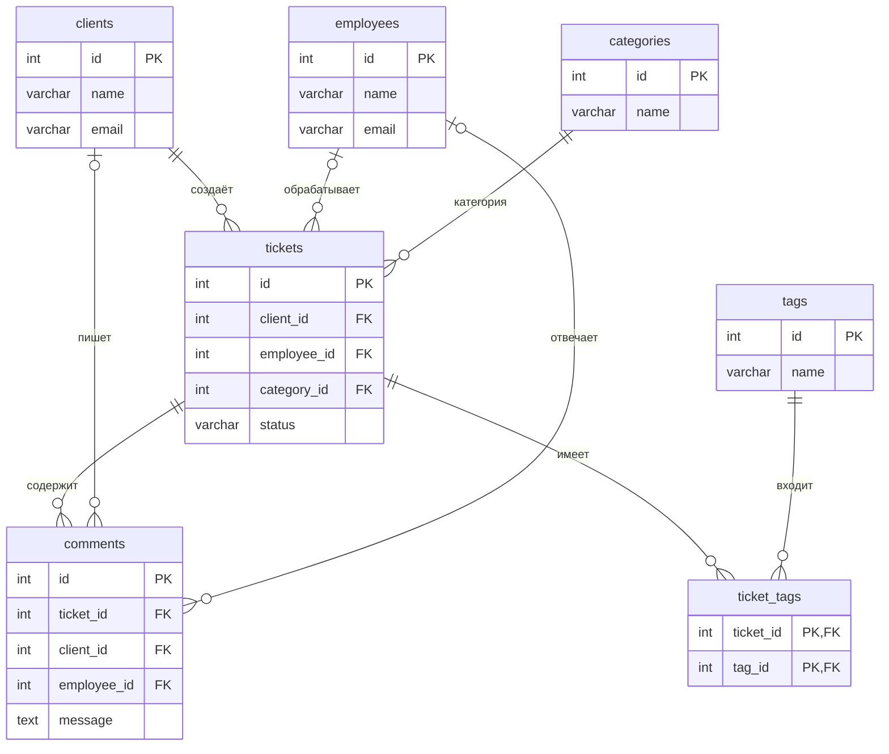

# Служба поддержки

Тема №19. База данных предназначена для хранения заявок клиентов и работы сотрудников службы поддержки.

| | |
| --- | --- |
| Главная таблица | `tickets` |
| Связь N:M | Заявки и теги через `ticket_tags` |
| СУБД | PostgreSQL 17 в Docker |

## Лабораторная работа №1

Задание: [docs/lab-1.md](docs/lab-1.md).

В работе создана база данных службы поддержки. Она содержит сведения о клиентах, сотрудниках, заявках, категориях, комментариях и тегах. Между таблицами установлены связи и ограничения для проверки данных.

## Как запустить

Создать файл `.env` из `.env.example` и указать пароли.

Запустить базу:

```bash
docker compose up -d
```

Подключиться к PostgreSQL:

```bash
docker compose exec db psql -U postgres -d app
```

При первом создании базы SQL-файлы из папки `db/` выполняются по порядку имён.

После изменения скриптов базу можно пересоздать:

```bash
docker compose down -v
docker compose up -d
```

Проверить лабораторную:

```bash
dbcheck --lab 1 --stars
dbcheck run demo/lab1.sql
```

## ER-диаграмма



В базе семь таблиц. Основная таблица `tickets` хранит заявки клиентов.

Связь многие-ко-многим между заявками и тегами реализована через таблицу `ticket_tags`. Одна заявка может иметь несколько тегов, а один тег может относиться к нескольким заявкам.

Составной первичный ключ из `ticket_id` и `tag_id` не позволяет назначить одной заявке один и тот же тег дважды.

## Ограничения

| Ограничение | Таблица и поля | Назначение |
| --- | --- | --- |
| `PRIMARY KEY` | Все таблицы | Уникальный идентификатор записи |
| `FOREIGN KEY` | `tickets`, `comments`, `ticket_tags` | Связь с существующими записями |
| `NOT NULL` | Обязательные поля | Запрет отсутствующих значений |
| `UNIQUE` | `clients.email`, `employees.email` | Запрет повторяющихся адресов |
| `UNIQUE` | `categories.name`, `tags.name` | Запрет одинаковых названий |
| `CHECK` | `tickets.status` | Проверка допустимых статусов |
| `CHECK` | `tickets.priority` | Приоритет от 1 до 3 |
| `CHECK` | `comments.client_id`, `comments.employee_id` | У комментария только один автор |

Ограничения позволяют избежать неправильных записей. Например, нельзя указать несуществующего клиента, повторить email или назначить заявке приоритет вне допустимого диапазона.

## Нормализация

До нормализации данные о заявках, клиентах, сотрудниках и категориях могли храниться в одной таблице:

| Заявка | Клиент | Email | Категория | Сотрудник |
| --- | --- | --- | --- | --- |
| 1 | Анна Иванова | anna@example.com | Авторизация | Андрей Ким |
| 11 | Анна Иванова | anna@example.com | Сайт | Ирина Белова |

В такой таблице имя и email одного клиента повторяются в разных заявках. Если клиент изменит email, его придётся исправлять в нескольких строках. При этом можно случайно изменить не все записи.

Для устранения повторов данные разделены на связанные таблицы:

- **1НФ:** каждое поле содержит одно значение, а не список. Например, теги одной заявки хранятся отдельными строками в `ticket_tags`.
- **2НФ:** неключевые поля зависят от всего первичного ключа, а не от его части. Большинство таблиц имеют простой ключ `id`. В `ticket_tags` используется составной ключ, но дополнительных неключевых полей нет.
- **3НФ:** неключевые поля не имеют транзитивных зависимостей от первичного ключа. Например, имя и email клиента зависят от идентификатора клиента, поэтому хранятся в `clients`, а не повторяются в `tickets`.

Теперь таблица `tickets` содержит внешний ключ `client_id`, который ссылается на таблицу `clients`.

В результате сведения о клиенте хранятся в одном месте, повторение данных уменьшается, а изменения не нужно вносить в каждую его заявку.

## Типы данных

| Тип | Использование |
| --- | --- |
| `SERIAL` | Автоматическая нумерация записей |
| `INT` | Идентификаторы и приоритет заявки |
| `VARCHAR` | Имена, email, названия и статусы |
| `TEXT` | Описания заявок и комментарии |
| `TIMESTAMPTZ` | Дата и время с учётом часового пояса |

Для имён и коротких строк используется `VARCHAR`, а для описаний и сообщений — `TEXT`, поскольку их длина может различаться.

Приоритет заявки хранится как целое число от 1 до 3. Статус может принимать значения `new`, `in_progress` и `closed`. Допустимые значения ограничены с помощью `CHECK`.

Денежных полей в базе нет, поэтому тип `NUMERIC` не используется.

## Что происходит при удалении

Для каждого внешнего ключа указано правило `ON DELETE`.

| Связь | ON DELETE | Причина |
| --- | --- | --- |
| Клиент — заявка | `RESTRICT` | Нельзя удалить клиента с заявками, чтобы не потерять связь с ним |
| Сотрудник — заявка | `SET NULL` | Заявка сохраняется и может быть назначена другому сотруднику |
| Категория — заявка | `RESTRICT` | Нельзя удалить используемую категорию, чтобы заявки не остались без категории |
| Заявка — комментарий | `CASCADE` | Комментарии относятся к конкретной заявке и удаляются вместе с ней |
| Клиент — комментарий | `RESTRICT` | Нельзя удалить клиента, пока сохраняются написанные им комментарии |
| Сотрудник — комментарий | `RESTRICT` | Нельзя удалить сотрудника, пока сохраняются его комментарии |
| Заявка — тег заявки | `CASCADE` | При удалении заявки связи с её тегами больше не нужны |
| Тег — тег заявки | `RESTRICT` | Нельзя удалить тег, пока он назначен заявкам |

`RESTRICT` запрещает удаление записи, если на неё есть ссылки. `CASCADE` удаляет зависимые записи, а `SET NULL` оставляет их, но очищает внешний ключ.

## Результат лабораторной работы №1

Созданы семь таблиц с первичными и внешними ключами, ограничениями и тестовыми данными.

В `db/01_schema.sql` описана структура базы, в `db/02_seed.sql` добавлены исходные записи, а `db/03_generate.sql` создаёт ещё 1000 заявок.

После генерации таблица `tickets` содержит 1015 записей.

В `demo/lab1.sql` проверяются три ограничения: `UNIQUE`, `CHECK` и `FOREIGN KEY`. Во всех трёх случаях база отклоняет неправильные вставки.

Автоматическая проверка `dbcheck` показала результат 6/6 по обязательным заданиям. Дополнительные задания также прошли автоматическую проверку и ожидают оценки преподавателем.
