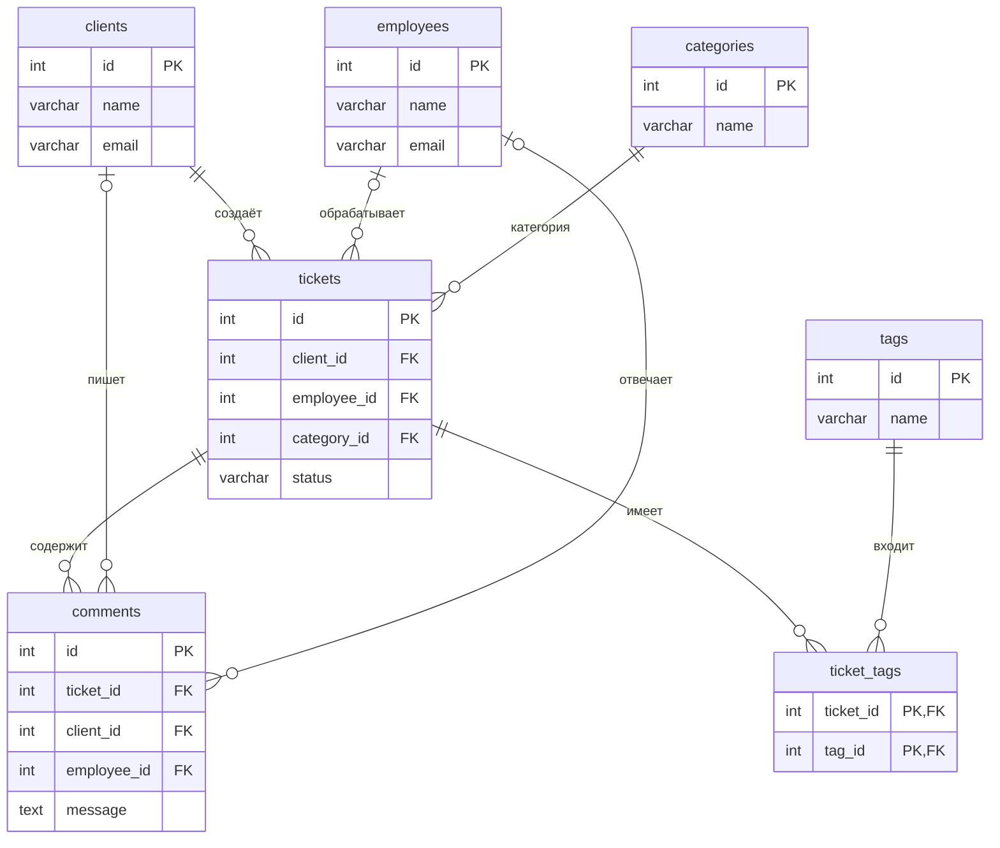

# Служба поддержки

Тема №19. База данных предназначена для хранения заявок клиентов и работы сотрудников службы поддержки.

| | |
| --- | --- |
| Главная таблица | `tickets` |
| Связь N:M | Заявки и теги через `ticket_tags` |
| Бизнес-правило | Заявку нельзя закрыть без ответа сотрудника |
| СУБД | PostgreSQL 17 в Docker |

## Задания курса

Правила курса, установка и порядок сдачи: [docs/README.md](docs/README.md).

| Лаба | Задание |
| --- | --- |
| 1. Модель данных и схема | [docs/lab-1.md](docs/lab-1.md) |
| 2. Запросы | [docs/lab-2.md](docs/lab-2.md) |
| 3. Логика в базе | [docs/lab-3.md](docs/lab-3.md) |
| 4. Транзакции и доступ | [docs/lab-4.md](docs/lab-4.md) |
| 5. Производительность | [docs/lab-5.md](docs/lab-5.md) |
| Витрина к защите | [docs/showcase.md](docs/showcase.md) |

## Как запустить

Создать файл `.env` из `.env.example` и указать пароли.

Запустить базу:

```bash
docker compose up -d
```

Подключиться к PostgreSQL:

```bash
docker compose exec db psql -U postgres -d app
```

При первом создании базы SQL-файлы из папки `db/` выполняются автоматически по порядку имён.

После изменения скриптов базу можно пересоздать:

```bash
docker compose down -v
docker compose up -d
```

## ER-диаграмма




В базе семь таблиц. Главная таблица `tickets` хранит заявки клиентов.

Связь многие-ко-многим между заявками и тегами реализована через таблицу `ticket_tags`. Её составной первичный ключ не позволяет добавить одной заявке одинаковый тег дважды.

## Ограничения

| Ограничение | Таблица и поля | Назначение |
| --- | --- | --- |
| `PRIMARY KEY` | Все таблицы | Уникальная идентификация записей |
| `FOREIGN KEY` | `tickets`, `comments`, `ticket_tags` | Связь с существующими записями |
| `NOT NULL` | Обязательные поля | Запрет пустых значений |
| `UNIQUE` | `clients.email`, `employees.email` | Запрет повторяющихся адресов |
| `UNIQUE` | `categories.name`, `tags.name` | Запрет одинаковых названий |
| `CHECK` | `tickets.status` | Допустимые статусы заявки |
| `CHECK` | `tickets.priority` | Приоритет от 1 до 3 |
| `CHECK` | `comments.client_id`, `comments.employee_id` | У комментария только один автор |

## Нормализация

До нормализации все данные могли храниться в одной таблице:

| Заявка | Клиент | Email | Категория | Сотрудник |
| --- | --- | --- | --- | --- |
| 1 | Анна Иванова | anna@example.com | Авторизация | Андрей Ким |
| 11 | Анна Иванова | anna@example.com | Сайт | Ирина Белова |

Данные одного клиента повторяются в нескольких заявках. При изменении его email пришлось бы исправлять несколько строк.

После нормализации данные разделены:

- **1НФ:** в каждом поле хранится одно значение.
- **2НФ:** данные таблицы зависят от её полного первичного ключа.
- **3НФ:** сведения о клиентах, сотрудниках и категориях вынесены в отдельные таблицы. В заявках хранятся ссылки на них.

Таким образом, повторение данных уменьшается, а изменение сведений о клиенте не требует исправления всех его заявок.

## Типы данных

| Тип | Использование |
| --- | --- |
| `SERIAL` | Автоматическая нумерация записей |
| `INT` | Идентификаторы и приоритет заявки |
| `VARCHAR` | Имена, email, названия и статусы |
| `TEXT` | Описания и комментарии |
| `TIMESTAMPTZ` | Дата и время создания с учётом часового пояса |

Статусы заявки ограничены с помощью `CHECK`, чтобы в базу нельзя было записать недопустимое значение.

## Что происходит при удалении

| Связь | ON DELETE | Причина |
| --- | --- | --- |
| Клиент — заявка | `RESTRICT` | Нельзя удалить клиента с заявками |
| Сотрудник — заявка | `SET NULL` | Заявка остаётся без назначенного сотрудника |
| Категория — заявка | `RESTRICT` | Нельзя удалить используемую категорию |
| Заявка — комментарий | `CASCADE` | Комментарии удаляются вместе с заявкой |
| Клиент — комментарий | `RESTRICT` | Нельзя удалить автора комментария |
| Сотрудник — комментарий | `RESTRICT` | Нельзя удалить автора комментария |
| Заявка — тег заявки | `CASCADE` | При удалении заявки удаляются её связи с тегами |
| Тег — тег заявки | `RESTRICT` | Нельзя удалить используемый тег |

## Что сделано по лабораторным

| Лаба | Что сделано | Сценарий |
| --- | --- | --- |
| 1 | Создание таблиц, связей, ограничений и тестовых данных | `demo/lab1.sql` |
| 2 | — | `demo/lab2.sql` |
| 3 | — | `demo/lab3.sql` |
| 4 | — | `demo/lab4.sql` |
| 5 | — | `demo/lab5.sql` |
